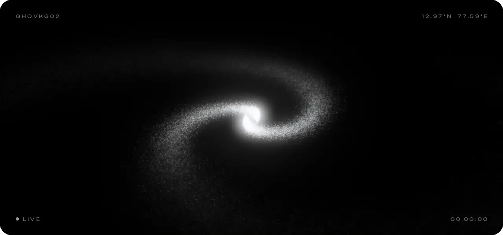
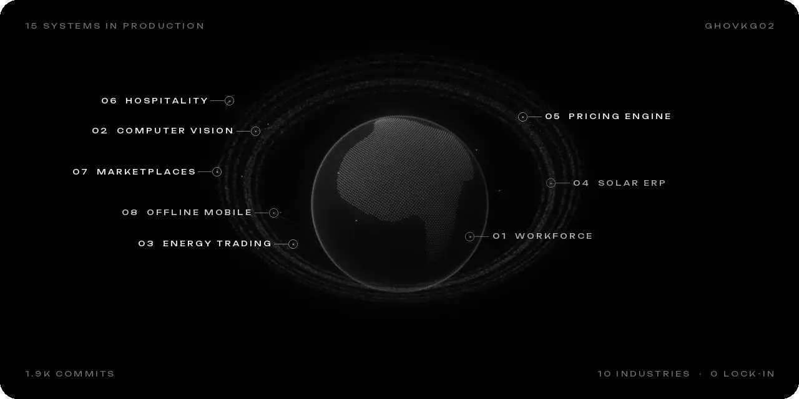

  

<a href="https://www.linkedin.com/in/ghovkg02"><picture><source media="(prefers-color-scheme: dark)" srcset="assets/linkedin-dark.png"><source media="(prefers-color-scheme: light)" srcset="assets/linkedin-light.png"></picture></a>
&nbsp;&nbsp;
<a href="mailto:ghovkg02@gmail.com"><picture><source media="(prefers-color-scheme: dark)" srcset="assets/email-dark.png"><source media="(prefers-color-scheme: light)" srcset="assets/email-light.png"></picture></a>

  

signal

 

